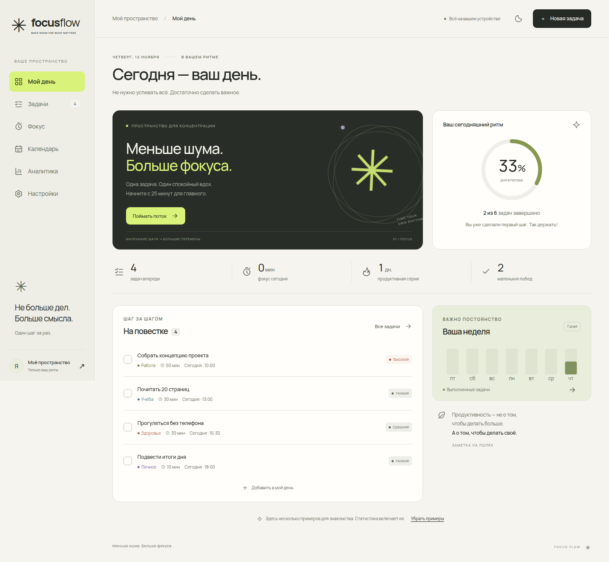

# ✳ FOCUS FLOW

**Меньше шума. Больше фокуса.** Персональный планировщик задач, времени и продуктивности.

Статическое приложение на HTML, CSS и Vanilla JavaScript. Без фреймворков, сборки, сервера, аккаунтов, API и runtime-зависимостей. Шрифт Manrope и SVG-иконки хранятся в репозитории — сторонних сетевых запросов нет.

## Возможности

- **Мой день:** задачи на сегодня, прогресс, оставшиеся дела, серия активных дней, минуты фокуса, недельная активность и быстрые действия.
- **Задачи:** создание, редактирование, подтверждаемое удаление, выполнение, описание, категория, приоритет, дата, время и оценка длительности. Поиск, фильтры, сортировка, drag-and-drop и кнопки перестановки. При первом запуске — явно обозначенные, удаляемые примеры.
- **Фокус:** Pomodoro, короткий и длинный перерывы, настраиваемые длительности, круговой индикатор, пауза, продолжение, сброс, привязка задачи. Расчёт по абсолютному deadline, а не числу interval-тиков. Сохранение при перезагрузке и восстановление завершённых сессий после сна вкладки. Звук выключен по умолчанию; уведомления запрашиваются только по нажатию.
- **Календарь:** месяц с понедельника, переключение месяцев, отметки задач, повестка выбранного дня, создание на выбранную дату, навигация стрелками.
- **Аналитика:** последние 7/30 дней, реальные завершённые задачи и минуты фокуса, активные дни, распределение по категориям и история сессий. Нулевые значения не заменяются выдуманной статистикой.
- **Настройки:** имя, светлая/тёмная тема, длительности, звук, уведомления, JSON-экспорт, проверяемый импорт с подтверждением, очистка примеров и полный сброс с подтверждением.
- **UX:** нижняя мобильная навигация, адаптация от 320 px, видимый keyboard focus, нативные модальные окна, live-уведомления, reduced-motion, состояния пустых списков и ошибок. Горячая клавиша **N** создаёт задачу, **Escape** закрывает диалог.

## Структура

```text
index.html                 семантическая оболочка и диалоги
css/styles.css             дизайн-система, анимации и адаптивность
js/app.js                  экраны, формы и события
js/store.js                схема, LocalStorage, валидация и статистика
js/timer.js                deadline-таймер и звуковой сигнал
js/charts.js               доступные SVG-графики
js/icons.js                inline SVG-иконки
fonts/                     локальный Manrope + лицензия OFL
screenshots/               итоговые desktop/mobile и остальные экраны
docs/DESIGN.md             концепция, архитектура и карта требований
docs/QA.md                 выполненные проверки и визуальный аудит
tests/                     необязательные браузерные QA-сценарии
.nojekyll                  прямая публикация статики на Pages
```

## GitHub Pages

1. Загрузите файлы в корень репозитория, ветка `main`.
2. Откройте **Settings → Pages → Build and deployment**.
3. Выберите **Deploy from a branch**, `main`, `/(root)`, затем **Save**.
4. Дождитесь успешного Pages deployment. Сайт доступен по `https://USERNAME.github.io/REPOSITORY/`.

Все пути относительные, навигация использует hash: приложение работает в подпапке репозитория. Сборка, npm и Node.js для запуска/публикации **не нужны**. ES-модули нужно открывать по HTTP(S), не через `file://`. Для необязательного локального просмотра можно использовать любой статический preview, например `python3 -m http.server 8765`.

## Данные и ограничения

Данные хранятся в LocalStorage под ключом `focus-flow.v1`. Синхронизация между вкладками одного origin поддерживается через storage events. Между устройствами и браузерами автоматической синхронизации нет — используйте JSON.

- Очистка данных сайта, приватный режим и смена браузера могут удалить/изолировать данные. Делайте резервные копии. Важное: GitHub Pages разных репозиториев одного владельца делят origin; ключ уникален для этого приложения, но не для его копий у того же владельца.
- Если запись в LocalStorage недоступна, изменения остаются в памяти и показывается предупреждение; их можно экспортировать.
- Импорт заменяет текущие данные после проверки и подтверждения. Максимум 5 МБ, 10 000 задач и 20 000 сессий. Активный таймер из импорта ставится на паузу.
- Звук и системные уведомления зависят от разрешений браузера. Закрытая/выгруженная страница не может подать сигнал; при следующем открытии завершённая сессия восстановится по deadline. Нет фонового push-сервера.
- Статистика задач считает текущие завершённые задачи по времени завершения. Возврат задачи в работу или её удаление убирает её из этой статистики. История завершённых фокус-сессий при удалении связанной задачи сохраняется. Серия учитывает дни с завершёнными задачами или фокус-сессиями.
- Категории фиксированы: работа, личное, учёба, здоровье. Недельный и месячный графики — скользящие периоды 7/30 дней. Автоматического переключения фокус/перерыв нет: следующий режим выбираете вы.

## Проверки

См. [docs/QA.md](docs/QA.md). Необязательные dev-сценарии используют Playwright; они не являются зависимостью приложения и не участвуют в публикации. Укажите `PLAYWRIGHT_MODULE` и `CHROME_PATH`, если инструменты установлены нестандартно. Затем при запущенном статическом preview:

```sh
node tests/e2e.cjs
node tests/quality.cjs
```

## Скриншоты



[Мобильный интерфейс](screenshots/mobile-390.png) · [Мобильный таймер](screenshots/mobile-focus.png) · [Тёмная тема](screenshots/dark-desktop.png) · [1920 px](screenshots/desktop-1920.png)

## Лицензия

Код — MIT. Manrope — SIL Open Font License (см. `fonts/OFL.txt`).
